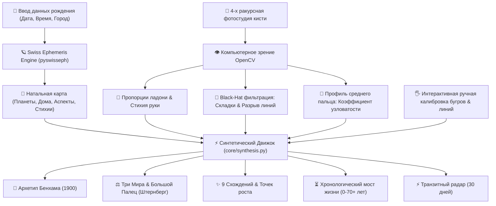

# 🧭 Полная Инструкция и База Знаний: AstroPalm Nexus
### Единая система синтеза Швейцарских Эфемерид, Компьютерного Зрения и Классической Хирологии

---

## Содержание
1. [Архитектура и логика работы системы](#1-архитектура-и-логика-работы-системы)
2. [База знаний по хиромантии и хирогномии: Первоисточники](#2-база-знаний-по-хиромантии-и-хирогномии-первоисточники)
   - [7 Морфологических типов кисти по Д'Арпентиньи](#7-морфологических-типов-кисти-по-дарпентиньи)
   - [Анатомия суставов и когнитивные узлы (PIP / DIP)](#анатомия-суставов-и-когнитивные-узлы-pip--dip)
   - [Онихогномия: 5 форм ногтевой пластины](#онихогномия-5-форм-ногтевой-пластины)
   - [7 Планетарных архетипов Уильяма Г. Бенхама (1900)](#7-планетарных-архетипов-уильяма-г-бенхама-1900)
   - [Доктрина Трех Миров фаланг Дебаролля и Штернберга](#доктрина-трех-миров-фаланг-дебаролля-и-штернберга)
   - [Королевская формула Большого Пальца](#королевская-формула-большого-пальца)
   - [Топография 9 холмов ладони](#топография-9-холмов-ладони)
   - [Главные линии и феномен раздельного истока (Independence of Mind)](#главные-линии-и-феномен-раздельного-истока-independence-of-mind)
   - [Динамика рук: Активная (Правая) vs Пассивная (Левая)](#динамика-рук-активная-правая-vs-пассивная-левая)
3. [Астрологическая расчетная модель (Swiss Ephemeris)](#3-астрологическая-расчетная-модель-swiss-ephemeris)
4. [Мост Синтеза: Как натальная карта соединяется с ладонью](#4-мост-синтеза-как-натальная-карта-соединяется-с-ладонью)
   - [Герметический принцип соответствия](#герметический-принцип-соответствия)
   - [Матрица проекций: Небо ⟷ Плоть](#матрица-проекций-небо--плоть)
   - [9 Алгоритмических критериев конвергенции](#9-алгоритмических-критериев-конвергенции)
   - [Хронологический мост времени (0–70+ лет)](#хронологический-мост-времени-070-лет)
5. [Откуда система черпает знания](#5-откуда-система-черпает-знания)
6. [Практическая инструкция пользователя](#6-практическая-инструкция-пользователя)

---

## 1. Архитектура и логика работы системы

Проект построен на модульной микросервисной архитектуре:
- **Backend:** Python 3.11, FastAPI, Uvicorn, NumPy, OpenCV (cv2), PySwissEph (`swisseph`).
- **Frontend:** Vanilla JavaScript (ES6+), Canvas 2D API высокой четкости, векторная графика SVG, адаптивный неоновый UI в стиле астрономической обсерватории.
- **Интерактивный холст (`PalmCanvas`):** двусторонняя связь. Пользователь может перетаскивать холмы и узлы линий прямо по фотографии ладони; при отпускании курсора фронтенд отправляет дельту координат и баллов, мгновенно вызывая фоновый пересчет герметического резонанса без перезагрузки страницы.

---

## 2. База знаний по хиромантии и хирогномии: Первоисточники

Знания проекта не взяты из газетных гороскопов. Они базируются на строгом академическом корпусе фундаментальных трудов XIX–XX веков.

### 7 Морфологических типов кисти по Д'Арпентиньи
Французский офицер Казимир д'Арпентиньи (*«La Chirognomonie»*, 1839) впервые классифицировал форму ладони и пальцев как индикатор биологического темперамента:
1. **Элементарная рука (Elementary):** грубая толстая ладонь, короткие пальцы. Преобладание базовых инстинктов, физической выносливости и практической простоты.
2. **Лопатообразная рука (Spatulate):** ладонь шире у основания или пальцев, кончики пальцев расширены лопаткой. Прикладные инженеры, изобретатели, новаторы, пионеры техники.
3. **Квадратная / Практическая рука (Square / Useful):** ширина ладони равна высоте, пальцы квадратные средней длины. Уважение к регламентам, надежность, организованность, закон и порядок (Стихия Земли).
4. **Философская / Узловатая рука (Philosophic):** угловатая ладонь, длинные костлявые пальцы с крупными узлами. Архитекторы сложных систем, философы, программисты, ученые. Ничего не принимают на веру без деконструкции (Стихия Воздуха + Сатурн).
5. **Коническая / Артистическая рука (Conical):** пальцы плавно сужаются конусом к кончикам. Эмоциональная восприимчивость, вдохновение, развитое эстетическое чутье (Стихия Воды / Венера).
6. **Психическая / Идеалистическая рука (Psychic):** тонкая, узкая, длинная ладонь с заостренными пальцами. Мистицизм, высокая духовность, слабая приспособленность к материальной рутине (Стихия Нептуна / Высшей Воды).
7. **Смешанная рука (Main Mixte):** комбинация признаков (например, квадратная ладонь с узловатыми пальцами). Самый частый тип современного человека, свидетельствующий о гибкой адаптивности и многопрофильном таланте.

---

### Анатомия суставов и когнитивные узлы (PIP / DIP)
В хирогномии суставы пальцев рассматриваются как **фильтры сопротивления мысли**:
- **Гладкие пальцы:** импульс от основания переходит к действию мгновенно. Человек мыслит интуитивно, схватывает картину целиком, не терпит занудной детализации.
- **Верхний узел (DIP — между ногтевой и 2-й фалангой) — «Узел Ума»:**
  Скепсис, потребность в поиске первопричин, проверка фактов, защита от пропаганды и авторитетов.
- **Нижний узел (PIP — между 2-й и 3-й фалангой) — «Узел Порядка»:**
  Любовь к систематизации, классификаторам, каталогам, чистоте программного кода, соблюдению регламентов.
- **Двойной узел (Двойной философский узел):**
  Признак системного мыслителя, способного синтезировать глубокую теорию с безошибочной технической структурой.

> [!NOTE]
> В AstroPalm Nexus встроен компьютерный алгоритм `detect_dorsal_knots_opencv`, который на тыльном фото замеряет ширину фаланг и суставов среднего пальца и вычисляет коэффициент узловатости: $\text{Knotty Ratio} = \frac{\text{Width}_{\text{joint}}}{\text{Width}_{\text{phalanx}}}$. При показателе $\ge 1.18$ рука автоматически классифицируется как философско-узловатая.

---

### Онихогномия: 5 форм ногтевой пластины
Форма ногтей отражает психомоторную скорость реакций нервной системы:
1. **Короткие квадратные ногти:** критический ум, природный аналитик, склонность к научным дискуссиям и фактчекингу.
2. **Длинные миндалевидные ногти:** миролюбие, образное мышление, развитая интуиция, стремление к гармонии.
3. **Широкие ногти (ширина превышает длину):** открытость, прямолинейность, обостренное чувство справедливости, напор.
4. **Веерообразные (трапециевидные):** высокая нервная возбудимость, жажда перемен, нетерпимость к рутине.
5. **Круглые / овальные:** дипломатичность, мягкость в общении, умение сглаживать острые углы.

---

### 7 Планетарных архетипов Уильяма Г. Бенхама (1900)
Американский врач и исследователь Уильям Бенхам в монографии *«The Laws of Scientific Hand Reading»* систематизировал человеческие психотипы по ведущему холму ладони:
- **Юпитерианец (The Jupiterian):** прирожденный лидер, амбиции, великодушие, чувство чести. Профессии: политики, топ-менеджеры, судьи. Зоны здоровья: печень, артериальное давление.
- **Сатурнианец (The Saturnian):** аналитик, исследователь, одиночка, математик. Профессии: архитекторы ПО, горные инженеры, ученые. Зоны здоровья: суставы, позвоночник, меланхолия.
- **Аполлонианец (The Apollonian):** харизматик, художник, генератор оптимизма. Профессии: искусство, дипломатия, дизайн. Зоны здоровья: сердечно-сосудистая система, зрение.
- **Меркурианец (The Mercurian):** оратор, коммерсант, диагност, комбинатор. Профессии: финансисты, IT-разработчики, врачи. Зоны здоровья: нервная система, бронхи.
- **Марсианец (The Martian):** воин, антикризисный управляющий, защитник. Профессии: хирурги, спасатели, испытатели. Зоны здоровья: гемодинамика, травмы.
- **Венерианец (The Venusian):** эмпат, жизнелюб, миротворец, гуманист. Профессии: психология, продюсирование, ресторанный бизнес. Зоны здоровья: водно-солевой обмен, эндокринология.
- **Лунианец (The Lunarian):** визионер, фантаст, мистик. Профессии: литераторы, исследователи глубин, мореплаватели. Зоны здоровья: лимфатическая система, ЖКТ.

---

### Доктрина Трех Миров фаланг Дебаролля и Штернберга
Л.Г. Штернберг и Адольф Дебаролль доказали, что фаланги каждого пальца делят проявление планетарной энергии на три октавы:
- **1-я (ногтевая) фаланга — Ментальный/Духовный мир:** идеи, теории, моральные принципы.
- **2-я (средняя) фаланга — Практический мир:** инженерия, расчет, бизнес-планирование, алгоритмы.
- **3-я (базовая) фаланга — Материальный мир:** осязаемый результат, телесный комфорт, ресурсы.

---

### Королевская формула Большого Пальца
Большой палец в хирологии называют «Королем Руки»:
$$\text{Большой Палец} = \underbrace{\text{1-я фаланга (Воля)}}_{\text{Марс / Солнце}} + \underbrace{\text{2-я фаланга (Логика)}}_{\text{Меркурий / Сатурн}} + \underbrace{\text{Тенар (Витальность / Страсть)}}_{\text{Холм Венеры}}$$
- Если $\text{Воля} > \text{Логика}$ — действия опережают анализ (риск авантюр).
- Если $\text{Логика} > \text{Воля}$ — избыточный анализ парализует действие («синдром отложенного старта»).
- Если $\text{Воля} \approx \text{Логика}$ — гармоничный волевой интеллект, способность доводить замыслы до воплощения.

---

### Главные линии и феномен раздельного истока (Independence of Mind)
На ладони выделяются 4 главные кардинальные магистрали:
1. **Линия Жизни (Vitality):** огибает холм Венеры; свидетельствует о физической конституции, запасе прочности организма и качестве заземления.
2. **Линия Головы / Ума (Mentality):** пересекает равнину Марса; отражает стиль мышления, концентрацию и пластичность нейросетей мозга.
3. **Линия Сердца (Emotionality):** течет под основаниями холмов Юпитера, Сатурна, Аполлона и Меркурия; отражает регистр чувств, способность к преданности и теплоту.
4. **Линия Судьбы / Сатурна (Fate / Destiny):** поднимается от браслетов запястья вертикально к Сатурну; отражает целеустремленность, карьерный стержень и осознание своего долга.

#### Раздельный исток Линии Головы и Линии Жизни:
- **Слитное начало:** Линия Головы начинается из той же точки, что и Линия Жизни. Это традиционный маркер осторожности, повышенной привязанности к семье, долгого разгона перед принятием ключевых решений.
- **Раздельное начало ($\text{Gap} \ge 15\,\text{px}$):**
  > [!IMPORTANT]
  > Это знак **Врожденной Ментальной Независимости** (*Independence of Mind*). Человек рано сепарируется от чужих мнений, не поддается стадному влиянию, обладает смелостью мыслить неортодоксально и готов брать личную ответственность за нестандартные ходы. Наш модуль компьютерного зрения автоматически замеряет этот зазор методом CLAHE и Black-Hat морфологии.

---

### Динамика рук: Активная (Правая) vs Пассивная (Левая)
- **Пассивная рука (обычно Левая у правшей):** фиксирует матрицу рождения, родовые предрасположенности, врожденный темперамент (соответствует натальной карте в момент первого вдоха).
- **Активная рука (обычно Правая у правшей):** отражает сознательную работу воли, приобретенные навыки, реальную эволюцию характера и то, как человек изменил исходную судьбу.
Сравнение линий между левой и правой рукой в модуле *Evolution Comparison* наглядно демонстрирует, насколько развит ваш личный волевой коэффициент.

---

## 3. Астрологическая расчетная модель (Swiss Ephemeris)

В отличие от упрощенных калькуляторов, проект использует официальную астрономическую библиотеку **Swiss Ephemeris (`pyswisseph`)** швейцарского центра Astrodienst (разработана Алоисом Трейнделом и Дитером Кохом на основе фундаментальных численных эфемерид NASA JPL DE431):
- **Точность:** субдуговая доля секунды ($< 0.001''$).
- **Координатная система:** геоцентрическая эклиптическая долгота с учетом нутации и прецессии земной оси.
- **Домофикация:** строго классическая система домов **Плацидуса (Placidus)**, признанная стандартом европейской классической школы для исследования судьбы и карьерных векторов.
- **Аспектный процессор:** расчет мажорных аспектов (Соединение $0^\circ$, Секстиль $60^\circ$, Квадратура $90^\circ$, Трин $120^\circ$, Оппозиция $180^\circ$) с динамическими орбами ($6^\circ-8^\circ$ для светил, $4^\circ-6^\circ$ для планет).

---

## 4. Мост Синтеза: Как натальная карта соединяется с ладонью

### Герметический принцип соответствия
> *«То, что внизу, подобно тому, что вверху, а то, что вверху, подобно тому, что внизу, чтобы совершить чудеса единого сущего»*  
> — Изумрудная Скрижаль Гермеса Трисмегиста

Астрология и хиромантия описывают **одну и ту же психическую реальность**, но на разных физических носителях:
- **Астрология** описывает *Космический Хронотоп*: вектор времени, энергетический ландшафт, стратегические фазы, в которые погружено сознание.
- **Хирология** описывает *Биологическую Соматизацию*: как эти космические архетипы буквально запечатлелись в нервных окончаниях, плотности мышечных холмов и бороздках эпидермиса вашей ладони.

---

### Матрица проекций: Небо ⟷ Плоть

| Небесный фактор (Натал) | Биометрический фактор (Ладонь) | Синтетическое значение |
|---|---|---|
| **Солнце ☉** (Ядро воли, харизма) | **Холм Аполлона** & Безымянный палец | Способность светить другим, артистизм, тяга к славе |
| **Луна ☽** (Психика, бессознательное) | **Холм Луны (Гипотенар)** | Сила интуиции, эмпатия, глубина воображения |
| **Меркурий ☿** (Интеллект, речь) | **Холм Меркурия** & Мизинец & **Линия Головы** | Комбинаторный ум, коммерческий дар, скорость нейросетей |
| **Венера ♀** (Чувства, гармония) | **Холм Венеры (Тенар)** & Линия Жизни | Запас жизненных сил, сексуальность, сердечная теплота |
| **Марс ♂** (Импульс, борьба) | **Холмы Марса** & Равнина Марса & 1-я фаланга большого пальца | Стойкость духа, напор, способность выдерживать кризисы |
| **Юпитер ♃** (Масштаб, авторитет) | **Холм Юпитера** & Указательный палец | Лидерские амбиции, экспансия, уважение к чести |
| **Сатурн ♄** (Карма, структура) | **Холм Сатурна** & Средний палец & **Линия Судьбы** | Дисциплина, философская глубина, верность призванию |
| **Стихии карты (Огонь/Земля/Воздух/Вода)** | **Пропорции ладони (Д'Арпентиньи)** | Темперамент: природный резонанс или творческий контраст |

---

### 9 Алгоритмических критериев конвергенции
В движке `core/synthesis.py` запрограммированы 9 строгих проверок, оценивающих резонанс:
1. **Стихийное соответствие:** Сравнение доминирующей стихии гороскопа со стихией ладони (например, Рука Воздуха при акценте Весов/Близнецов дает гармоничный резонанс мысли).
2. **Морфология Асцендента:** Сопоставление восходящего знака с пропорциями ладони.
3. **Меркурианский контур:** Сопоставление знака Меркурия с протяженностью и направлением Линии Головы.
4. **Сатурнианский стержень:** Сопоставление дома и знака Сатурна с четкостью и глубиной Линии Судьбы.
5. **Венерианский витальный тонус:** Сопоставление силы Венеры в карте с объемом холма Венеры на руке.
6. **Онихогномический регистр:** Согласованность формы ногтей с ментально-волевой динамикой Меркурия и Марса.
7. **Архетипический резонанс по У. Бенхаму:** Выявление ведущего планетарного холма и проверка положения его управителя в натальной карте.
8. **Баланс Трех Миров и Формула Большого Пальца (Штернберг):** Проверка соотношения ментальной, практической и материальной энергии по фалангам.
9. **Врожденная Ментальная Независимость:** Детекция раздельного истока линий Головы и Жизни ($\text{Gap} \ge 15\,\text{px}$) и сопоставление с сигнатурой суверенности гороскопа (Уран/Марс/1-й дом).

Итоговый **Индекс Резонанса Систем** варьируется от $62\%$ до $98\%$. Высокий процент указывает на идеальную слаженность внутренних устремлений и их физического воплощения.

---

### Хронологический мост времени (0–70+ лет)
В модуле `core/chronology.py` соединены две независимые шкалы времени:
- **Хирологическая датировка Беньхама:** Линия Жизни и Линия Судьбы градуируются от точки старта до запястья с шагом в 7-летние и 10-летние циклы.
- **Астрологические циклы взросления:**
  - 14 лет: первая квадратура Сатурна к натальному (пубертатный кризис воли).
  - 21 год: полуфаза Урана и квадратура Сатурна (кризис сепарации от родителей).
  - 24 года: второй возврат Юпитера (первый крупный социальный трамплин).
  - **29.5 лет: Первый Возврат Сатурна (Saturn Return):** главный рубеж зрелости, перестройка Линии Судьбы, проверка на прочность целей.
  - 40–42 года: оппозиция Урана и квадратура Нептуна (кризис середины жизни, трансформация Линии Головы).
  - 58–60 лет: Второй возврат Сатурна и возврат Юпитера (обретение статуса мудреца-наставника).

Система рассчитывает текущий точный возраст пользователя и сопоставляет активную точку на линии ладони с текущей астрологической фазой.

---

## 5. Откуда система черпает знания

База знаний AstroPalm Nexus формируется из трех проверенных источников:
1. **Академический архив трактатов классической хирологии:**
   - *Уильям Г. Бенхам*, «The Laws of Scientific Hand Reading» (New York/London, 1900).
   - *Л. Г. Штернберг*, «Хиромантия и тайны руки» (СПб, 1890-е гг.).
   - *Адольф Дебаролль*, «Les Mystères de la main révélés et expliqués» (Paris, 1859).
   - *Казимир д'Арпентиньи*, «La Chirognomonie» (Paris, 1839).
   - *Граф Луис Хамон («Cheiro»)*, «Language of the Hand» (London, 1897).
   - *Граф де Сен-Жермен*, «The Practice of Palmistry» (Chicago, 1897).
2. **Астрономические численные базы данных:**
   - Эфемеридные файлы NASA Jet Propulsion Laboratory (JPL DE431).
   - Алгоритмический швейцарский движок Swiss Ephemeris.
3. **Методы биометрии и компьютерного зрения (Computer Vision):**
   - Библиотека OpenCV: CLAHE (Contrast Limited Adaptive Histogram Equalization), Black-Hat морфологические операторы сегментации кожных борозд, полиномиальная интерполяция Безье.

---

## 6. Практическая инструкция пользователя

1. **Ввод данных рождения:**
   - Введите имя, дату рождения (поддерживаются любые форматы: `20.09.1992`, `1992-09-20`), время и город. Поле города автоматически геокодирует координаты и часовой пояс.
   - Нажмите кнопку **«✨ Рассчитать натальную карту и синтез»**.
2. **Загрузка фотографий в 4-х ракурсную студию:**
   - **Правая (Ладонь):** основное фото активной ладони при прямом освещении с раскрытыми пальцами.
   - **Правая (Снаружи):** тыльная сторона кисти для замера узловатости суставов и формы ногтей.
   - **Левая (Ладонь и Снаружи):** для сопоставления врожденного потенциала и прижизненной эволюции.
3. **Живая интерактивная калибровка:**
   - Холст ладони поддерживает перетаскивание холмов прямо курсором мыши или пальцем на тачскрине.
   - Кнопка **«⚓ Точки линий»** активирует маркеры Линии Сердца, Головы и Жизни.
   - Кнопки **«✂️ Раздельное начало»** и **«🔗 Слитное начало»** позволяют мгновенно настроить исток линий и увидеть изменение трактовки.
   - Клик на любой холм открывает модальное окно выбора степени наполненности (55 / 72 / 86 / 95 баллов) и особых знаков (✨ Звезда, 🔱 Трезубец, 🔺 Треугольник, ⛨ Квадрат).
4. **Изучение результатов синтеза:**
   - Перейдите в секцию синтеза (или нажмите ссылку **«👇 Посмотреть синтез»** в статусном баре).
   - Изучите ваш Архетип по Бенхаму, прогресс-бары Трех Миров по Штернбергу, хронологический мост жизни и динамический транзитный радар на ближайшие 30 дней.
   - Для сохранения нажмите **«📥 Экспорт отчета»** или **«🖨️ Печать»**.
